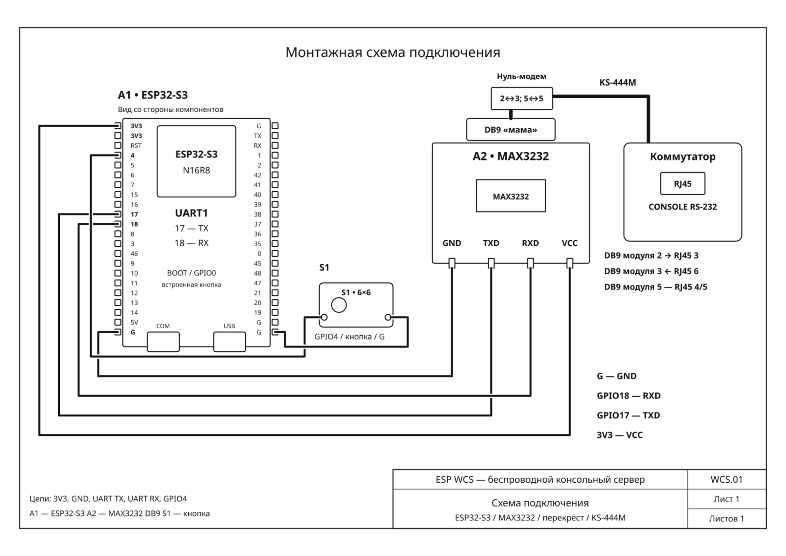
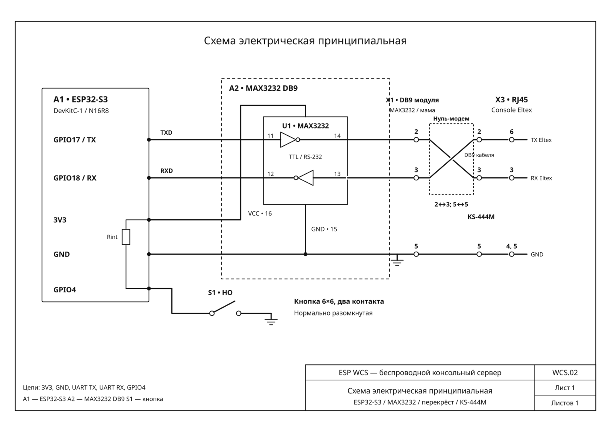

# Консоль RS-232: проверенная сборка и вариант для корпуса

## Что подтверждено на реальном устройстве

**2026-11-07:** пользователь подтвердил работу консоли **Eltex MES2308R**
через ESP WCS и бастион на **115200 бод, 8N1, без управления потоком**.
Обычный Backspace для этого подключения должен отправлять **BS / Ctrl+H (0x08)**.
Параметры ESR-12VF — 115200 8N1 без управления потоком по документации;
обмен с этим маршрутизатором в ходе данной проверки не испытывался.

**Ключевое исправление:** прямое соединение нашего MAX3232 DB9 «мама» с
KS-444M не работает. Нужен перекрёст **DB9 2↔3, 5↔5 между модулем и кабелем**.
Прежнее утверждение «null-modem не нужен» и прежние назначения направлений
RJ45 были ошибочными. Рабочий обмен пользователь получил после этого перекрёста.
На стороне ESP провода **GPIO17 → TXD, GPIO18 ← RXD остаются без изменений**.

Разъём RJ45 в этом документе — **Console RS-232, не Ethernet**.
Распайка относится к проверенному экземпляру MES2308R и нашей сборке;
для другого оборудования совместимость проверяется отдельно.

## Текущий комплект

- ESP32-S3-DevKitC-1 N16R8; параметры железа в прошивке — только в `firmware/main/board.h`.
- Модуль MAX3232 с DB9 **«мама»** и четырьмя штырьками **GND, TXD, RXD, VCC**.
  По описанию продавца: MAX3232CSE, плата 31 × 22 мм, до 150 кбит/с.
  Размеры перед проектированием корпуса измеряются на реальном экземпляре.
- Четыре провода ESP ↔ MAX3232. Питание модуля в проекте — **3,3 В**.
- Кабель **KS-is KS-444M: DB9 «папа» → RJ45 «папа»**.
- Между DB9 модуля и кабеля — перекрёст 2↔3, земля 5↔5.
  На испытании использовались три Dupont «папа–мама»; это временный монтаж.
  Готовая замена — **KS-is KS-387, нуль-модемный DB9 «папа–мама»**;
  сам купленный переходник в этой проверке ещё не испытывался.

```text
ESP → MAX3232 DB9 «мама» → перекрёст 2↔3 / 5↔5 → KS-444M → Console MES2308R
```

Есть также рабочий Cisco-кабель **DB9 «мама» → RJ45 «папа»**, маркировка
`72338301 REV A2 94841LOR 1112 cisco`. С Moxa UPort 1110 он показал
`User Name:` на 115200 8N1. Для соединения двух DB9 «мама» (модуль + Cisco)
нужен **нуль-модемный «папа–папа»**, а не простой прямой gender changer.

## Четыре провода ESP ↔ MAX3232: не переставлять TXD/RXD

| Штырёк модуля | ESP | Место на плате | Ножка MAX3232 | Назначение |
| --- | --- | --- | --- | --- |
| GND | G | J1-22 | 15 | Общая земля |
| TXD | GPIO17 | J1-10 | 11, DIN1 | TTL-вход передатчика от ESP |
| RXD | GPIO18 | J1-11 | 12, ROUT1 | TTL-выход приёмника к ESP |
| VCC | 3V3 | J1-1 | 16 | Питание модуля от 3,3 В |

На нашем модуле надпись **TXD означает вход**, а RXD — выход. Ориентироваться
по подтверждённым цепям, не применять правило «TX всегда соединять с RX»
к надписям разных модулей без проверки. Выводы TX/RX возле USB на ESP — UART0
прошивки и логов; к MAX3232 они не подключаются.

Порядок штырьков при чтении надписей слева направо:

```text
Модуль:   GND    TXD    RXD    VCC
ESP:       G     17     18    3V3
```

Не подавать на модуль 5 В в этой сборке. RS-232 нельзя соединять непосредственно
с GPIO ESP: преобразователь MAX3232 и его конденсаторы сохраняются.

## Три цепи на стороне DB9 нашего MAX3232

| Контакт DB9 модуля | Ножка MAX3232 | Функция относительно ESP |
| --- | --- | --- |
| **2** | **14, DOUT1** | **Выход RS-232**, передача к коммутатору |
| **3** | **13, RIN1** | **Вход RS-232**, приём от коммутатора |
| **5** | **15, GND** | Общая сигнальная земля |

Именно такая распайка подтверждена для этого модуля. У стандартного COM-порта
компьютера DB9 «папа» передача обычно на №3, приём на №2; наш DB9 «мама»
устроен наоборот. Один лишь пол разъёма не гарантирует назначения сигналов.
Второй канал MAX3232 в этой сборке не используется.

Пары DIN1/DOUT1 (11/14) и RIN1/ROUT1 (13/12) — активное преобразование,
а не провод: сквозной прозвонки от GPIO до RJ45 через микросхему не должно быть.
Раннее чтение TXD → ножка 10 исправлено: **верно TXD → ножка 11**.

## Кабели: проверять отдельно от переходников

На **обоих** проверенных кабелях — KS-444M и Cisco — пользователь получил:

| Контакт DB9 самого кабеля | Контакт RJ45 самого кабеля |
| --- | --- |
| 2 | 6 |
| 3 | 3 |
| 5 | **4 и 5** |

Это карта проводимости отдельно взятого кабеля, а не готовая схема подключения
к MAX3232. Контакты 4/5 RJ45 — общая земля. Остальные контакты не нужны для
проверенного трёхпроводного обмена; их распайка здесь не подтверждена.
RTS/CTS и программное управление потоком отключены.

После добавления перекрёста сигналы идут так:

```text
ESP GPIO17 → TXD → DIN1 11 / DOUT1 14 → DB9 модуля 2
                                              ↓ перекрёст
                                        DB9 кабеля 3 → RJ45 3 → RX Eltex

ESP GPIO18 ← RXD ← ROUT1 12 / RIN1 13 ← DB9 модуля 3
                                              ↑ перекрёст
                                        DB9 кабеля 2 ← RJ45 6 ← TX Eltex

G ESP ─ GND / ножка 15 ─ DB9 модуля 5 ─ DB9 кабеля 5 ─ RJ45 4 и 5
```

В нуль-модемном KS-387 есть также служебные соединения, но здесь используются
только 2, 3 и 5. Отсутствие №9 для этого обмена не мешает. Прямой переходник
2→2, 3→3, 5→5 не заменяет нуль-модемный.

## Нумерация: «мама», «папа» и сторона пайки

Не определять номер как «слева» без указания стороны и ориентации разъёма.
По возможности сверяться с мелкими литыми номерами на изоляторе.

**DB9: вид со стороны соединения, ряд из пяти сверху.**

```text
«Мама», смотреть в отверстия:       «Папа», смотреть на штырьки:
        5  4  3  2  1                      1  2  3  4  5
         9  8  7  6                        6  7  8  9
```

Со стороны пайки изображение зеркальное. **Наш DB9 «мама», вид сзади,
ряд из четырёх сверху, ряд из пяти снизу** (так выполнялись замеры):

```text
  9  8  7  6
5  4  3  2  1
```

Здесь №5 — крайний левый нижний, №3 — средний нижний, №2 — второй справа
нижний. Эти указания нельзя переносить на вид в отверстия или на DB9 «папа».

**RJ45 штекер:** золотые контакты сверху, защёлка снизу, кабель к себе,
носик от себя; контакты слева направо 1–8. Для гнезда и его паяных выводов
не переносить этот вид зеркально «на глаз»: нужна схема изготовителя конкретного
гнезда и проверка через вставленный прямой патч-корд. Цвета внутренних проводов
адаптера или жил кабеля не являются номерами контактов.

**MAX3232, вид сверху на корпус, выемка сверху:**

```text
          выемка
        ┌───∪───┐
     1 ─┤       ├─ 16 VCC
     2 ─┤       ├─ 15 GND
     3 ─┤       ├─ 14 DOUT1 → DB9 2
     4 ─┤       ├─ 13 RIN1  ← DB9 3
     5 ─┤       ├─ 12 ROUT1 → RXD
     6 ─┤       ├─ 11 DIN1  ← TXD
     7 ─┤       ├─ 10
     8 ─┤       ├─  9
        └───────┘
```

Ножка 6 MAX3232 — V− зарядового насоса, не выход данных и не земля.
Не путать её с контактом №6 DB9 или RJ45.

## Как нашли неисправность: журнал проверки 2026-11-07

1. Плата онлайн в бастионе, UART 115200 8N1. Enter увеличивал TX, RX оставался
   нулевым; ошибок кадра, чётности и переполнений не было. TX подтверждает только
   приём байтов драйвером, а не получение их коммутатором.
2. Без кабеля и коммутатора замкнули **DB9 модуля 2 и 3**. Тестовая строка
   вернулась: отправлено и получено 14 байт, ошибок нет.
3. Подключили KS-444M, оставив RJ45 отключённым от Eltex. Замкнули **RJ45 3 и 6**:
   снова 14 байт туда и обратно, ошибок нет. Проверены оба направления нашей
   сборки, но петля сама по себе **не проверяет правильность перекрёста с Eltex**.
4. Moxa UPort 1110 появился как `/dev/ttyUSB0`; через Cisco-кабель Eltex ответил
   `User Name:` на 115200 8N1. Исправность консоли Eltex подтверждена.
5. Прозвонены оба кабеля. Путаница DB9 №1/№5 из-за зеркального вида устранена:
   земля на **№5**, не №1; она соединена с RJ45 №4 **и** №5 у обоих кабелей.
6. Замеры DC относительно DB9 №5 показали, что на №2 кабеля приходит передача
   Eltex, а №2 MAX3232 также является передатчиком. При прямом соединении
   получалось TX↔TX и RX↔RX. Две успешные петли этому не противоречат.
7. Три провода **2→3, 3→2, 5→5 между модулем и KS-444M** устранили проблему;
   пользователь подтвердил рабочую консоль Eltex через ESP WCS.

### Измеренные напряжения

| Где и при каком подключении | Результат |
| --- | --- |
| Провода от ESP: 3V3 относительно G, сняты с MAX3232 | +3,2948 В |
| VCC относительно GND на включённом модуле | +3,2915 В |
| DB9 модуля: №2 относительно №5, линия в покое | −6,09 В |
| DB9 модуля: №3 относительно №5 при прежнем прямом подключении, также без Eltex | около 0 В (+0,001 В) |
| Cisco: RJ45 в Eltex, DB9 свободен; №2 относительно №5 | −5,6 В |
| KS-444M: RJ45 в Eltex, DB9 свободен; №2 относительно №5 | −5,6 В |
| KS-444M при том же подключении: №3 относительно №5 | около 0 В |

Это результаты конкретного экземпляра, не универсальные точные нормы.
Отрицательное напряжение покоя на передающей линии RS-232 ожидаемо;
его измерение не заменяет проверку передачи данных и не показывает форму импульсов.

### Мультиметр APPA 305 и щупы пользователя

- **Жёлтый щуп вставлен в COM**, **синий — в V/Ω**. Ориентироваться на гнёзда,
  не на стандартные слова «чёрный/красный».
- Прозвонка: кабель снят с оборудования с обеих сторон, питание отключено;
  выбрать позицию диода/прозвонки и жёлтой кнопкой — звуковой режим.
  Замкнуть щупы для проверки писка.
- Напряжение: DC V (значок постоянного напряжения), не Ω и не прозвонка.
  Жёлтый COM — к GND/DB9 5, синий — к измеряемому контакту.
- Питание без нагрузки измеряли на контактах внутри снятых с модуля Dupont
  VCC/GND от ESP; под нагрузкой — на площадках обратной стороны модуля.
- Перестановку проводов и пайку выполнять без питания и с отключённым кабелем
  Eltex. Не замыкать щупом соседние контакты; не разжимать разъёмы толстым щупом.

## Вариант для корпуса: убрать DB9, оставить один RJ45

### Выбранное исполнение, согласовано 2026-11-07

Пользователь выбрал выпаять DB9 с существующего модуля MAX3232, припаять
к его площадкам жилы короткого отрезка обычного кабеля витой пары и завести
их в задний обжимной механизм панельной розетки RJ45 D-типа. Розетка крепится
к стенке будущего 3D-печатного корпуса. Внутренний штекер RJ45, DB9 и внешние
переходники в этом исполнении не используются. Кандидат розетки — панельный
разъём CAT5E с обжимным механизмом, артикул Амперкот 40122583; исполнение
контактов, отсутствие magnetics, допустимые жилы и полную глубину нужно
подтвердить перед покупкой. Само изделие ещё не испытано.

Внешнее соединение — обычный **прямой патч-корд**, контакт 1→1 … 8→8,
в Console проверенного MES2308R. Разводка: площадка DB9 2→RJ45 3,
DB9 3→RJ45 6, DB9 5→RJ45 4/5. Это выбранная конструкция, а не уже
подтверждённое испытанием новое изделие. Не обещать абсолютную совместимость
с любым портом RJ45 или любым оборудованием. До окончательной печати корпуса
обязательны прозвонка через фактический внешний патч-корд, петля и обмен с Eltex.

Жилы подключать по номерам электрических контактов, не по цветам или
положению ножек на розетке. Для IDC/обжимного механизма сверить тип жил
(многопроволочные/однопроволочные) и AWG: тонкая многопроволочная жила
патч-корда подходит не к каждой розетке. Если выбранный механизм рассчитан
только на однопроволочную витую пару, для внутреннего участка использовать
соответствующий кабель. Места пайки и кабель закрепить от натяжения.


**Да, можно убрать DB9 и припаять три провода от его сигнальных площадок к
пассивному гнезду RJ45 (8P8C).** MAX3232 с конденсаторами, питанием 3,3 В и
четырьмя соединениями с ESP остаётся. В обычном консольном кабеле DB9↔RJ45
для этих цепей нет необходимой активной логики: это проводники. Преобразование
уровней выполняет MAX3232. У USB-консольного кабеля, напротив, есть электроника;
его не следует считать таким же пассивным кабелем.

### Распайка внутреннего RJ45 для прямого патч-корда

| Проверенная точка на текущем модуле | Сигнал относительно ESP | Контакт внешнего гнезда RJ45 |
| --- | --- | --- |
| **Площадка бывшего DB9 №2** (связана с MAX3232 14) | Выход RS-232, TX | **3** |
| **Площадка бывшего DB9 №3** (связана с MAX3232 13) | Вход RS-232, RX | **6** |
| **Площадка бывшего DB9 №5** (GND, MAX3232 15) | Земля | **4 и 5** |

К гнезду идут **три электрические цепи**; земля разветвляется на два контакта,
поэтому к самому гнезду будет четыре соединения. Остальные контакты RJ45
**1, 2, 7, 8 оставить неподключёнными**. Металлический экран не заменяет землю
контактов 4/5; его соединение с сигнальной землёй отдельно пока не определено.

```text
ESP ──4 провода── MAX3232 ──TX, RX, GND── RJ45 в корпусе
                                             │
                              прямой патч-корд Cat5e/Cat6
                                             │
                                      Console MES2308R
```

Такой порт на ESP WCS имеет TX на 3 и RX на 6, то есть уже содержит нужную
разводку для прямого патч-корда к проверенному Eltex (RX на 3, TX на 6).
Внешний null-modem, KS-444M и KS-935 при этом не нужны. **Не добавлять второй
перекрёст и не использовать rollover/Cisco RJ45↔RJ45 вместо прямого патч-корда.**
Это проектируемый вариант: фактическая сборка с новым RJ45 ещё не испытывалась.
Вывод о его разводке получен из проверенной рабочей цепочки с перекрёстом.

### Какое гнездо и как крепить

- Пассивное **RJ45/8P8C без встроенных трансформаторов (без magnetics/MagJack)**.
  Гнездо с Ethernet-трансформаторами не подходит для этой разводки RS-232.
- Для прототипа без своей печатной платы удобнее гнездо на маленькой плате
  с подписанными выводами или клеммами, либо пассивная панельная розетка.
  Это избавляет от пайки к тонким ножкам. Обычный пассивный keystone с IDC
  также возможен, но он крупнее и требует подходящего типа проводников.
- Подходят простое гнездо без светодиодов и короткий патч-корд;
  наличие Ethernet-категории не делает порт Ethernet.
- Гнездо должно механически крепиться к корпусу/плате, а не висеть на трёх
  проводах. Усилие вставки и вытаскивания кабеля не должно нагружать пайку MAX3232.
- Внутренние провода короткие, с изоляцией и фиксацией; места пайки изолировать.
  Плату MAX3232 закрепить отдельно, держать металлические части вдали от ESP.
- Разъёмы COM/USB ESP для прошивки/питания, доступ к BOOT/RESET и положение
  антенны учитывать при проектировании корпуса. По возможности не размещать
  металлическое гнездо и проводку вплотную к антенне; проверить связь уже в корпусе.
- Размеры выреза, защёлку и точки крепления брать с выбранного гнезда;
  финальную 3D-модель корпуса делать после выбора и замера реальных компонентов.

### Демонтаж и проверка до печати корпуса

1. Полностью обесточить ESP и отсоединить Eltex. Отметить/сфотографировать
   площадки DB9 2/3/5, сверить прозвонкой с MAX3232 14/13/15.
2. Выпаивать корпус DB9 целиком при наличии инструмента; он держится не только
   на трёх рабочих контактах, но и на остальных выводах и механических креплениях.
   **Не выламывать разъём и не тянуть непрогретый:** можно оторвать дорожки.
   Если снимать трудно, первый прототип можно собрать от паяных площадок сзади,
   оставив DB9 внутри корпуса; для компактной окончательной сборки убрать его позже.
3. Сохранить микросхему, конденсаторы зарядового насоса и питающие цепи модуля.
   Припаиваться удобнее к площадкам DB9, не к тонким ножкам микросхемы.
4. По документации выбранного RJ45 найти его реальные паяные выводы. Без питания
   прозвонить через вставленный **прямой патч-корд**: площадка DB9 2 → контакт 3
   свободного штекера, DB9 3 → контакт 6, земля → 4/5. Проверить отсутствие замыканий
   между TX/RX/GND и неиспользуемыми линиями. Так исключается ошибка зеркального вида.
5. Снять все тестовые перемычки. Проверить питание модуля и петлю 3↔6 на свободном
   конце патч-корда, отключённом от Eltex. Полученное эхо проверяет обе стороны
   преобразователя и кабель, но само по себе не подтверждает совместимость порта.
6. Убрать петлю, подключить Console MES2308R, выставить 115200 8N1 и проверить
   ввод/вывод и BS. Убедиться, что механическое шевеление кабеля не рвёт связь.
7. Только после этого закреплять компоновку и печатать окончательный корпус.
   На корпусе подписать **CONSOLE RS-232**; не подключать этот порт к Ethernet/PoE.

Промежуточный вариант без пайки — **KS-is KS-935 (без O)**, DB9 «папа» →
RJ45 «мама» с настраиваемыми контактами: DB9 2→RJ45 3, DB9 3→RJ45 6,
DB9 5→RJ45 5. Второй контакт земли RJ45 4 можно добавить, если конструкция
позволяет надёжно объединить две жилы; для трёхпроводной схемы достаточно
земли на 5. Модель **KS-935O** имеет DB9 «мама» и напрямую к нашему модулю
не подключается. KS-443 рассчитан на пару удлинителей и без карты распайки
не является готовым консольным переходником.

## Схемы

[WCS.01 и WCS.02](schematics/README.md) отражают текущую сборку **с обязательным
перекрёстом DB9 2↔3**. Вариант корпуса без DB9 описан выше и не подменяет
проверенную сборку на этих чертежах. SVG — оригиналы, PNG — их отображение.
Схемы не восстанавливают внутреннюю заводскую схему модуля, зарядовый насос
и номиналы его конденсаторов. Внешняя кнопка показана как проектный элемент.





## Внешняя кнопка S1

Двухконтактная тактовая кнопка 6×6 мм, без фиксации, нормально разомкнутая:

```text
GPIO4 (J1-4, надпись «4») ── S1 ── G (например, J3-22)
```

У кнопки нет полярности. Можно использовать свободный G на правом ряду ESP:
все выводы G соединены между собой; землю MAX3232 отключать не нужно.
Ножки кнопки на беспаечной макетке должны попасть в разные электрически
соединённые группы отверстий. На отключённой от ESP кнопке прозвонка должна
пищать только при нажатии.

**Поддержка GPIO4 ещё не реализована:** текущая прошивка использует BOOT / GPIO0
(`BOARD_BUTTON_GPIO` в `firmware/main/board.h`). Для внешней кнопки планируется
внутренняя подтяжка GPIO4 к 3V3, активный уровень 0. Отдельный внешний резистор
для коротких проводов не предусмотрен. На принципиальной схеме внутренняя подтяжка обозначена Rint внутри ESP. Замыкание GPIO4 на землю
с текущей прошивкой не вызывает переключения режима.

## Источники и пределы подтверждения

Основное доказательство текущей разводки — пользовательские прозвонки,
замеры и успешный обмен 2026-11-07, записанные выше.

- [TI MAX3232: DIN1 11, DOUT1 14, RIN1 13, ROUT1 12, GND 15, VCC 16](https://www.ti.com/product/MAX3232).
- [KS-is KS-387: нуль-модемная распайка](https://ks-is.com/adapter-com-interfejsa-db9-db9-rs232-male-female-nul-modemnyj-ks-is-ks-387).
- [Molex: RJ45 со встроенными магнитными компонентами](https://www.molex.com/en-us/products/connectors/modular-connectors/rj45-with-magnetics) — такой тип отличается от нужного пассивного гнезда.
- [Eltex MES: 115200, 8N1, без управления потоком](https://docs.eltex-co.ru/pages/viewpage.action?pageId=45452583).

Готовые KS-387/KS-935 и новая сборка без DB9 пока не проверены на нашем железе.
Работа на 115200 не подтверждает максимальную скорость всех модулей MAX3232,
любую длину кабеля или совместимость со всеми устройствами с RJ45.
