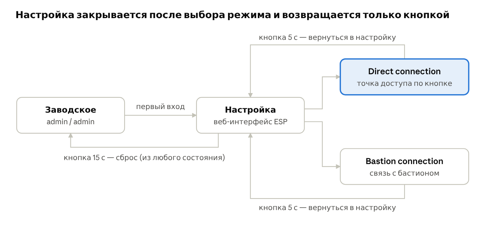

# ТЗ: беспроводной консольный сервер на ESP32-S3

26.10.2026 · Кирилл Шафранов

> Конвертировано из [`source/tz.docx`](source/tz.docx). Уточнения по железу, проверенные на плате,
> — в [`hardware/esp32-s3-n16r8-board.md`](hardware/esp32-s3-n16r8-board.md) и `CLAUDE.md`
> (в частности, RGB-светодиод на **GPIO48**, а не GPIO38).

## Цель и режимы

Беспроводной консольный сервер на ESP32-S3: плата подключается к консольному порту коммутатора или маршрутизатора и даёт доступ к его консоли по Wi-Fi. Работа идёт в три этапа: сначала Direct connection (MVP), затем Bastion connection, затем фичи.

У устройства два рабочих режима:

- **Direct connection** — ESP сама поднимает точку доступа, ноутбук подключается к ней напрямую, и через веб-терминал в браузере вы работаете с консолью устройства.
- **Bastion connection** — ESP подключается к обычной Wi-Fi сети и сама устанавливает соединение с бастионом (свой сервер на Elixir). Работа с консолью идёт через веб-терминал бастиона, там же управление всеми ESP.

Выбор режима делается в состоянии «Настройка» через веб-интерфейс ESP. После выбора режима интерфейс настройки закрывается, чтобы никто посторонний не мог в него попасть. Вернуть его можно только физически, долгим нажатием кнопки на устройстве.

Интернет не нужен ни для одной функции: всё работает в полностью изолированной сети.

## Принятые решения

Прошивка пишется на ESP-IDF, бастион на Elixir/Phoenix, консоль подключается через UART и MAX3232.

| Область | Решение |
|---|---|
| Прошивка ESP | ESP-IDF (нужен для mTLS, генерации ключей, Secure Boot и Flash Encryption) |
| Бастион | Elixir/Phoenix, каждое ESP — отдельный процесс, веб-терминал на xterm.js |
| Подключение к консоли | UART ESP → MAX3232 → консольный порт (RJ45 / DB9). USB-кабели не используем: на ESP нужны драйверы под каждый чип |
| Веб-терминал | xterm.js, файлы хранятся во флеше ESP (CDN недоступен — интернета нет) |
| Шифрование | HTTPS везде. ESP ↔ бастион — mTLS. Бастион — собственный центр сертификации |
| Доверие к бастиону | ESP запоминает сертификат бастиона при первом подключении и дальше подключается только к нему |
| Регистрация ESP | заявка с устройства, одобрение на бастионе, бастион подписывает сертификат |
| Время | ESP получает время от бастиона. В Direct connection время не нужно |
| Адрес бастиона | IP, домен или bastion.local (mDNS) |
| Сеть для Bastion connection | обычный Wi-Fi с паролем, DHCP. Корпоративные сети (WPA2-Enterprise), статический IP и прокси не поддерживаем |
| Сессии консоли | одновременно управляет только один человек. Остальным — «Устройство занято», режима «только чтение» нет |
| Пользователи | одна учётная запись администратора. Роли — в фичах |
| Питание | powerbank (нужен с режимом малого тока: ESP потребляет 50–150 мА, и обычный powerbank может отключиться) |

## Железо

Плата совместима с ESP32-S3-DevKitC-1 v1.1 (модуль ESP32-S3-WROOM-1-N16R8, светодиод на GPIO38). Консоль подключается через модуль MAX3232 (только пины, без DB9) к разъёму RJ45.

### Плата

- Модуль ESP32-S3-WROOM-1-N16R8: 16 МБ Flash, 8 МБ Octal PSRAM.
- Разъём **COM** — через чип USB-UART на UART0 (GPIO43/44): прошивка и логи ESP-IDF.
- Разъём **USB** — нативный USB (GPIO19/20), в проекте пока не используется, можно брать питание.
- Надпись «USB OTG» на обороте относится к питанию порта USB в режиме хоста. Нам это не нужно, ничего не трогаем.
- Питание: powerbank в любой из двух разъёмов.

### Распределение пинов

| Назначение | Пин ESP | Место на плате |
|---|---|---|
| Консоль TX → MAX3232 | GPIO17 (U1TXD) | J1, пин 10 |
| Консоль RX ← MAX3232 | GPIO18 (U1RXD) | J1, пин 11 |
| Питание MAX3232 | 3V3 | J1, пин 1 |
| Земля MAX3232 | G | J1, пин 22 |
| RGB-светодиод | GPIO38 | встроенный |
| Кнопка режимов | GPIO0 (кнопка BOOT) | встроенная |

Не используем: GPIO35–37 (PSRAM), GPIO19/20 (USB), GPIO43/44 (логи), strapping-пины GPIO0, 3, 45, 46 для внешних подключений. Кнопка BOOT годится для MVP, но если держать её при подаче питания, ESP уйдёт в режим прошивки. Для корпуса позже выведем отдельную кнопку, например на GPIO4.

### Подключение MAX3232 → RJ45

Распиновка консоли Cisco (её же используют большинство производителей), кабель обжимается по T568B.

| MAX3232 (сторона RS-232) | Пин RJ45 | Цвет (T568B) | Сигнал устройства |
|---|---|---|---|
| RX (R1IN) | 3 | бело-зелёный | TxD — устройство передаёт |
| TX (T1OUT) | 6 | зелёный | RxD — устройство принимает |
| GND | 4 или 5 | синий или бело-синий | земля |

Остальные жилы RJ45 не подключаются, аппаратное управление потоком (RTS/CTS) не нужно.

### Важно при сборке

- MAX3232 питаем строго от **3V3**, не от 5V: иначе на GPIO18 придёт 5 В.
- Подписи TX/RX на китайских модулях бывают перепутаны. Если консоль молчит, первым делом поменять местами провода на GPIO17/18.

## Состояния и кнопка

У устройства четыре состояния: «Заводское», «Настройка», Direct connection и Bastion connection. В рабочих режимах интерфейса настройки нет совсем: ESP не отдаёт эти страницы, а не просто прячет их за паролем.

*Состояния устройства: 4 состояния, переходы по кнопке*

| Нажатие кнопки | Действие |
|---|---|
| Короткое | в Direct connection поднять точку доступа |
| 5 секунд | вернуться в «Настройку» (нужен пароль администратора) |
| 15 секунд | сброс до заводских настроек из любого состояния |

Состояние показывается встроенным RGB-светодиодом. Цвета для каждого состояния определим при разработке. Решено одно: в Bastion connection красный означает «нет связи с бастионом».

## Этап 1 (MVP): Direct connection

Цель этапа: подключиться ноутбуком к Wi-Fi ESP, открыть консоль в браузере и вводить команды на коммутаторе. Сначала ESP настраивается через веб-интерфейс, затем выбирается Direct connection, и настройка закрывается.

### Первый запуск и настройка

- При первом запуске ESP поднимает точку доступа для настройки с заводским паролем Wi-Fi.
- Вход в веб-интерфейс: admin / admin.
- Смена пароля администратора и пароля Wi-Fi настройки всегда требует ввода текущего пароля.
- Что задаётся в настройке:
   - пароль администратора;
   - пароль Wi-Fi точки настройки;
   - имя (SSID) и пароль Wi-Fi для Direct connection;
   - скорость консольного порта (ручной выбор, по умолчанию 9600) и параметры линии (по умолчанию 8N1);
   - режим: Direct connection (Bastion connection появится на этапе 2).
- Кнопка «Применить»: ESP сохраняет настройки, закрывает интерфейс настройки и переходит в выбранный режим.

### Работа в Direct connection

- Короткое нажатие кнопки поднимает точку доступа.
- Если за 5 минут никто не подключился, точка доступа выключается. После отключения клиента таймер 5 минут запускается заново.
- К точке доступа может подключиться только один клиент.
- Вход по логину и паролю администратора, затем открывается веб-терминал.
- Веб-терминал: xterm.js, данные идут через WebSocket напрямую в UART и обратно.
- В терминале есть кнопка отправки сигнала BREAK (нужен для восстановления пароля на Cisco).
- Одновременно открыта только одна сессия терминала. Вторая вкладка или второй браузер получает «Устройство занято».

### Безопасность в MVP

- HTTPS с самоподписанным сертификатом. Ключ и сертификат генерируются на ESP при первом запуске, срок действия до 2099 года.
- Пароль администратора хранится хэшем с солью. Пароли Wi-Fi хранятся в NVS как есть (для точки доступа они нужны в открытом виде), а защитит их Flash Encryption на этапе 3.
- Защита от перебора: после 5 неверных попыток пауза с нарастающим временем.
- Точка доступа только с WPA2 (WPA3, если ноутбуки поддерживают).
- Сессия хранится в cookie с флагами Secure и HttpOnly.

### Модули прошивки

- Хранилище настроек (NVS).
- Wi-Fi: точка доступа, ограничение на одного клиента, таймер выключения.
- HTTPS-сервер: страницы, вход, WebSocket.
- Мост WebSocket ↔ UART и BREAK.
- Авторизация: хэши паролей, сессии, защита от перебора.
- Машина состояний: «Заводское», «Настройка», Direct connection.
- Кнопка (короткое нажатие, 5 с, 15 с) и RGB-светодиод.

### Порядок работ

1. Проверить связку ESP → MAX3232 → консоль коммутатора: простое эхо UART через USB-порт ESP.
2. Точка доступа, веб-сервер, xterm.js и мост WebSocket ↔ UART (пока по HTTP).
3. Перевести всё на HTTPS с генерацией сертификата на устройстве.
4. Вход, сессии, хэши паролей, защита от перебора, «Устройство занято».
5. Веб-интерфейс настройки и хранение настроек в NVS.
6. Машина состояний, кнопка, светодиод, закрытие настройки после выбора режима.
7. Таймер выключения точки доступа и ограничение на одного клиента.

## Этап 2: Bastion connection

Цель этапа: ESP сама подключается к бастиону, а вы работаете с консолью и управляете устройством через веб-интерфейс бастиона. Точку доступа ESP в этом режиме не поднимает.

### Настройка на ESP

- В «Настройке» выбирается Bastion connection и задаются: имя и пароль Wi-Fi сети, адрес бастиона (IP, домен или bastion.local).
- После «Применить» настройка закрывается, ESP подключается к Wi-Fi и бастиону.

### Регистрация устройства

1. ESP генерирует свою ключевую пару. Приватный ключ никогда не покидает устройство.
2. При первом подключении ESP запоминает сертификат бастиона и дальше подключается только к нему.
3. ESP отправляет заявку: ID устройства, имя и запрос на сертификат (CSR).
4. На бастионе заявка появляется как «ожидает одобрения». Администратор одобряет или отклоняет её.
5. При одобрении бастион подписывает сертификат и отправляет его ESP. Дальше все подключения идут по mTLS.
6. Отзыв устройства — кнопка на бастионе. Отозванное устройство больше не подключится.

### Соединение ESP с бастионом

- Соединение всегда устанавливает ESP: WebSocket поверх TLS, исходящее подключение, поэтому NAT не мешает.
- После подключения ESP получает время от бастиона.
- Heartbeat каждые N секунд, по нему бастион понимает, что устройство онлайн.
- При обрыве ESP переподключается с нарастающей паузой и не сдаётся.
- Нет связи с бастионом — светодиод горит красным.

### Протокол (состав сообщений)

Подробную спецификацию напишем в начале этапа. Обязательные типы сообщений:

- заявка на регистрацию и ответ (одобрено, отклонено, ожидает);
- heartbeat;
- данные консоли (бинарные кадры в обе стороны);
- управление консолью: скорость и параметры линии, BREAK;
- блокировка консоли: занять, освободить, «устройство занято»;
- команды устройству: перезагрузка, изменение настроек, отзыв;
- статус устройства: версия прошивки, время работы, уровень сигнала Wi-Fi;
- синхронизация времени.

### Управление ESP с бастиона

- Полный контроль над всеми настройками ESP: консольный порт, Wi-Fi, перезагрузка, отзыв.
- Перед сменой Wi-Fi показывать предупреждение: при ошибке в пароле устройство потеряет связь, и вернуть его можно будет только кнопкой на месте.

### Бастион на Elixir

- При первом запуске генерирует корневой сертификат (свой центр сертификации).
- Вход для одного администратора.
- Список устройств: онлайн или офлайн, заявки на одобрение, отозванные.
- Одобрение, отклонение и отзыв устройств.
- Веб-терминал на xterm.js с блокировкой «Устройство занято».
- Страница «Скачать корневой сертификат» с инструкцией для Windows, macOS и Linux.
- Объявляет себя в сети как bastion.local через mdns_lite.
- Работает и локально (например, на ноутбуке в сети раздачи с телефона), и на сервере с доменом.

### Порядок работ

1. Написать спецификацию протокола ESP ↔ бастион.
2. Бастион: каркас Phoenix, корневой сертификат, вход администратора.
3. Бастион: WebSocket-эндпоинт для ESP, регистрация, одобрение, список устройств.
4. ESP: подключение к Wi-Fi, генерация ключей, запоминание сертификата бастиона, заявка, получение сертификата.
5. mTLS, heartbeat, переподключение, время от бастиона.
6. Веб-терминал на бастионе и блокировка консоли.
7. Удалённое управление настройками ESP, отзыв.
8. mDNS и страница с корневым сертификатом.

## Этап 3: фичи

После двух этапов работающее устройство дополняется функциями ниже. Порядок внутри списка примерный, его можно менять.

| Фича | Суть |
|---|---|
| Автоопределение скорости порта | ESP перебирает 9600–115200, отправляет Enter и проверяет, похож ли ответ на текст. Ручной выбор остаётся |
| Заливка конфигов | загрузка текстового конфига в бастион, ESP отправляет его построчно и после каждой строки ждёт приглашение (#, >) |
| Буфер истории консоли | кольцевой буфер в PSRAM: при подключении видно, что устройство выводило до вас. В Bastion connection вывод копится и при обрыве связи |
| Сертификат веб-интерфейса ESP от бастиона | после регистрации бастион выдаёт ESP сертификат для HTTPS, и браузер с установленным корневым сертификатом перестаёт показывать предупреждение |
| Secure Boot и Flash Encryption | защита ключей и паролей от чтения флеша. Прожигается в eFuse необратимо, включается только на финальной прошивке |
| OTA прошивки ESP | обновление прошивки самой ESP через бастион, только подписанные прошивки, откат при неудаче |
| Логирование сессий | запись ввода и вывода консоли с метками времени, хранение и поиск на бастионе |
| Роли пользователей | несколько пользователей, роли (администратор, оператор) и доступ к отдельным устройствам |

## Исключено и открытые вопросы

### Не делаем

- Заливку прошивок сетевого оборудования (XMODEM) и TFTP — через устройство заливаются только конфиги.
- Подключение консоли через USB-кабели — только UART и MAX3232.
- Режим «только чтение» для второго пользователя.
- Корпоративные сети (WPA2-Enterprise), статический IP и прокси.
- Доступ по telnet без шифрования — только HTTPS.

### Открытые вопросы

- ☐ Железо и распиновка: раздел написан, проверить при первой сборке.
- ☐ Заводской пароль Wi-Fi точки настройки: WPA2 требует минимум 8 символов, поэтому admin не подойдёт. Нужен другой, например adminadmin.
- ☐ Принудительная смена пароля admin / admin при первом входе.
- ☐ Цвета светодиода для каждого состояния.
- ☐ Формат ID устройства (например, по MAC-адресу) и имя точки доступа.
- ☐ Интервал heartbeat и время, после которого бастион считает устройство офлайн.
